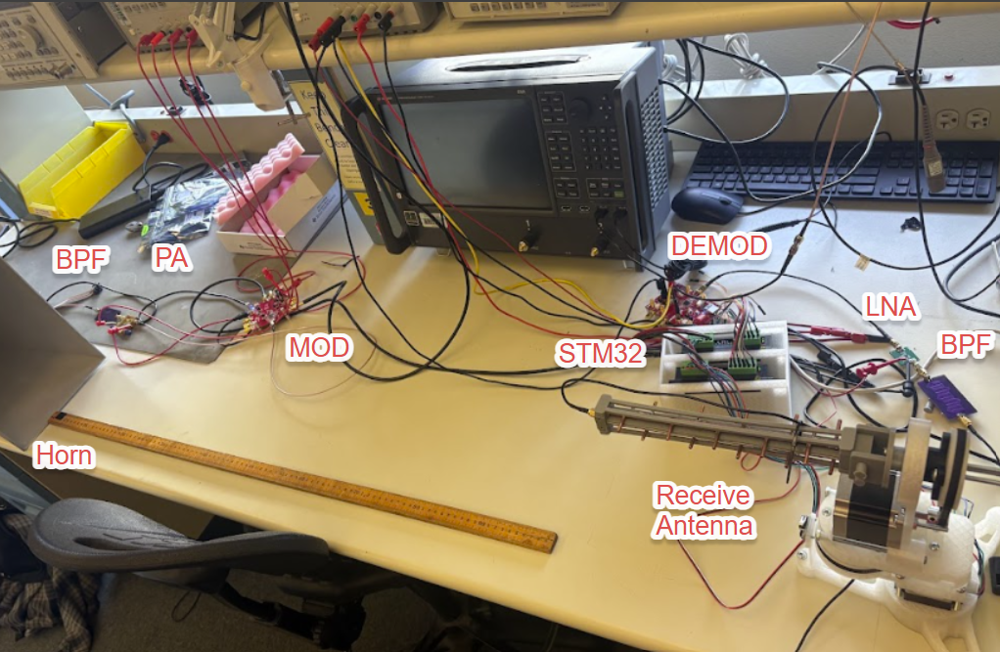

# Antenna Measurement System

A two-axis antenna test stand developed within a collaborative 2.45 GHz communication-system project. The stand
positions an antenna under test and supports live polar plotting, while the broader RF link combines antennas,
amplification, filtering, IQ modulation/demodulation, and a microcontroller interface.

**Status:** Hardware prototype and integration tests documented. The report identifies an unresolved issue with
accurate ADC capture of the recovered baseband signal.

## System and Verification

The test stand uses an STM32L4A6ZG and stepper-motor positioning. The report describes an analog-input sweep
used to verify the live plotting path and synthetic test data used to exercise polarization and pattern-processing
displays. Those display checks are distinct from a calibrated antenna-pattern measurement.

The assembled 2.45 GHz link produced a corresponding demodulator response to a transmitted baseband input,
observed on an oscilloscope. Accurate capture of the recovered 40 kHz square wave by the STM32 ADC was not
achieved in the reported demonstration. Further investigation of the ADC configuration and physical baseband
interface was identified as the next step.

## Files and Scope

- [Communication and antenna measurement report](docs/communication-and-measurement-report.pdf)
- [Firmware repository cited by the report](https://github.com/jackm2983/mmwLab)

The included report describes the complete team system, including antennas, a PCB LNA, a hairpin filter, and the
modulator/demodulator chain. The report's PCB LNA is a separate circuit from the UMS-process 2.5 GHz LNA in
this portfolio. Measurement firmware and later automation scripts are not included in the current upload.

## Team Credits

The report lists Antoni Gonzalez, Leo Joseph Alvelais, Paul Obrecht, Jack Marshall, Mark Negus, and William Robert
Pfaff. This page describes the team system; subsystem-level authorship is not assigned beyond the supplied report.

[Measurement and automation](../README.md) | [Portfolio](../../README.md)
