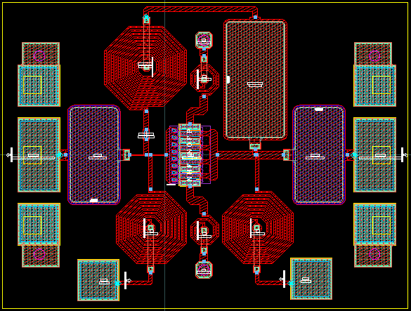

# 2.5 GHz UMS Low Noise Amplifier

A low noise amplifier developed in Keysight ADS using the UMS GH15 GaN HEMT process. The work follows the
design from device geometry and bias selection through stabilization, matching tradeoffs, layout, back annotation,
and RFPro electromagnetic extraction.

**Status:** Completed circuit, layout, and simulation study documented in the supplied report. Results below are
simulated, not measured hardware performance.

## Design Approach

The selected transistor uses eight 60 micrometer gate fingers. A drain-to-gate feedback network and inductive source
degeneration stabilize the device while balancing noise, gain, and matching. Dedicated input and output matching
networks were evaluated, then removed to reduce component count and passive loss. The remaining circuit and its
layout interconnects were optimized together.

RFPro was used in two stages: extraction of interconnects, pads, and vias, followed by extraction of the full passive
layout while retaining the active transistor as a circuit model. This comparison showed why the back-annotated
schematic alone did not capture all layout effects.

## Final Reported Simulation Results

| Metric | Final full-passive-EM / active-device result |
| --- | --- |
| Gain at 2.3 GHz | 11.765 dB |
| Gain at 2.7 GHz | 11.271 dB |
| Noise figure near 2.5 GHz | Approximately 1.14 dB; read from the plotted curve |
| Input reflection coefficient over 2-3 GHz | Below approximately -12 dB |
| Output reflection coefficient over 2-3 GHz | Below approximately -19 dB |

Earlier stabilization studies include wideband K and B1 sweeps. The final EM figures do not contain a final wideband
stability sweep, a layout-level yield analysis, or a large-signal linearity assessment.

## Files

- [Complete design report](docs/ums-lna-report.pdf)
- [Passive layout used for the final extraction](figures/passive-em-partition.png)

The ADS workspace and foundry PDK are not included. The report contains the design sequence, schematics,
layout, and simulation comparisons.

## Credits

Report author: Leo Alvelais. The report credits Anurag Bhargava's UMS LNA tutorial for the initial circuit workflow,
then develops the compact layout and RFPro model. Supporting Keysight and UMS references are listed in the report.

[RF and microwave circuits](../README.md) | [Portfolio](../../README.md)
