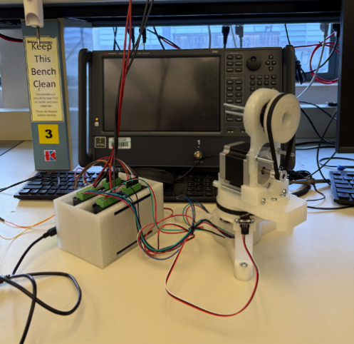

# Antenna Measurement System

A two-axis test stand was built to position an antenna under test and display received power as a function of angle.
The stand was developed as part of a 2.45 GHz communication-system project.

Figure 1. Antenna measurement test stand.

## Integration and Results

The stand uses an STM32L4A6ZG and stepper-motor positioning. An analog input sweep was used to check the live
plotting path. Synthetic data was used to check the polarization and pattern-processing displays.

Figure 2. Integrated 2.45 GHz test bench.

The assembled RF link produced a corresponding response at the demodulator output. This was observed on an
oscilloscope. Accurate capture of the recovered baseband signal by the STM32 ADC was not achieved in the reported
demonstration. The ADC configuration and baseband connection were identified for further testing.

## Files

- [Team report](docs/communication-and-measurement-report.pdf)
- [Firmware repository cited in the report](https://github.com/jackm2983/mmwLab)

The report also covers the antennas, PCB LNA, filters, and modulator/demodulator chain. Its PCB LNA is separate
from the UMS MMIC design in this portfolio. Later measurement scripts are not included.

Team: Antoni Gonzalez, Leo Joseph Alvelais, Paul Obrecht, Jack Marshall, Mark Negus, and William Robert Pfaff.

[Measurement system](../README.md) | [Portfolio](../../README.md)
