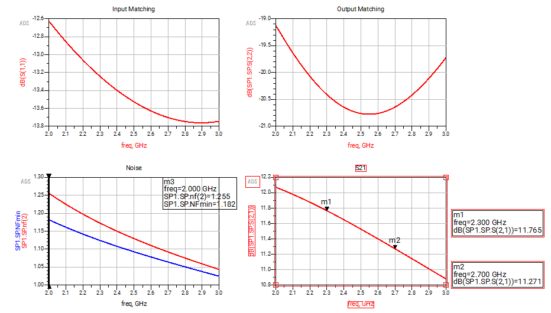

# 2.5 GHz UMS Low Noise Amplifier

A low noise amplifier was developed in ADS using the UMS GH15 GaN HEMT process. The design includes device
biasing, stabilization, impedance matching, layout, and RFPro electromagnetic simulation.

Figure 1. Amplifier layout used for RFPro analysis.

## Design and Results

The transistor geometry and bias point were selected first. Feedback and inductive source degeneration were then
used to improve stability. Input and output matching networks were evaluated before moving the circuit into layout.

Removing the dedicated matching networks reduced the component count and passive loss. The remaining circuit
retained useful gain and matching, so this topology was used for the compact layout.

Figure 2. Full passive EM extraction with the transistor retained as a circuit model.

The RFPro response shows lower gain than the back-annotated schematic. Matching remains suitable across the
studied band, and the noise figure stays close to the extracted circuit minimum. This shows why the physical
interconnects and passive layout need to be included in the final assessment.

Results are simulated. The earlier stability sweeps describe the stabilization stages; a final wideband sweep of the
complete EM model is not included.

## Files

- [Design report](docs/ums-lna-report.pdf)
- [Passive EM partition](figures/passive-em-partition.png)

Design report: Leo Alvelais. The initial circuit workflow follows Anurag Bhargava's UMS LNA tutorial, as credited
in the report. The ADS workspace and foundry PDK are not included.

[MMIC designs](../README.md) | [Portfolio](../../README.md)
