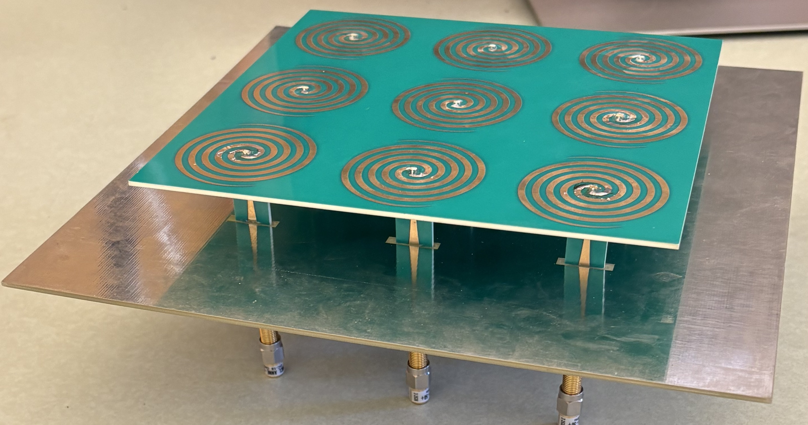

# Leo Alvelais

A collection of electrical engineering projects I have worked on individually and with others. Most if not all of the projects revolve around wireless communications and antennas/antenna arrays.

## Antenna Designs

| Project | Description |
| --- | --- |
| [Archimedean Spiral Array](antenna-designs/archimedean-spiral-array/) | Two 3 x 3 arrays with vertically integrated Klopfenstein and exponential baluns. Simulation and measured input matching are compared. |
| [2-3 GHz Axial-Mode Helical Antenna](antenna-designs/axial-mode-helical-antenna/) | Helix and printed match track optimized together. Includes the design history and simulation results. |
| [4 GHz Probe-Fed Patch Array](antenna-designs/4ghz-probe-fed-patch-array/) | Circular Taylor aperture, probe-fed patch design, and HFSS array construction. The report covers the earlier 2.4 GHz revision. |
| [1-Bit Phase-Reconfigurable Leaky-Wave Antenna](antenna-designs/1bit-phase-reconfigurable-leaky-wave-antenna/) | Preview of ongoing antenna work. |

## MMIC Designs

| Project | Description |
| --- | --- |
| [2.5 GHz UMS Low Noise Amplifier](MMIC-designs/2500mhz-ums-lna/) | Device biasing, stabilization, matching, layout, and RFPro simulation using the UMS GH15 process. |

## Antenna Measurement System

| Project | Description |
| --- | --- |
| [Antenna Measurement System](Antenna-measurement-system/antenna-measurement-system/) | Two-axis test stand, live plotting, and integration with a 2.45 GHz communication link. |

## SDR and STM32 Projects

| Project | Description |
| --- | --- |
| [MATLAB SDR Tools](SDR-STM32-Projects/matlab-sdr-tools/) | Carrier and timing synchronization studies, with testing on ADALM-Pluto. |
| [LoRide Vehicle Telemetry](SDR-STM32-Projects/loride-vehicle-telemetry/) | OBD-II/CAN acquisition, STM32 firmware, and a 915 MHz LoRa link. |

[Credits and references](CREDITS.md)
