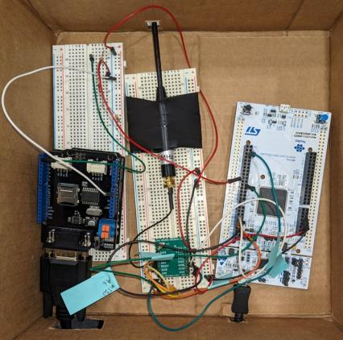

# LoRide Vehicle Telemetry

LoRide is a wireless vehicle-health monitoring system. It consists of a vehicle node and a base node, each using
an STM32 Nucleo board and an RFM95W LoRa radio. The nodes communicate at 915 MHz.

Figure 1. LoRide prototype.

## System

An Arduino and CAN shield read the vehicle's OBD-II responses. The data is passed to the STM32 through UART,
decoded, and packed into a compact binary payload. The vehicle node sends the payload over LoRa. The base node
recovers the sensor values and displays them through a serial terminal.

Figure 2. Vehicle-node wiring diagram by Juan Gonzalez.

The firmware separates the radio interface, serial communication, sensor decoding, and display functions. The
protocol sends telemetry in one direction without acknowledgements.

## Files

- [Team report and source listings](docs/loride-report.pdf)
- [Firmware source](source/)
- [Original code archive](archive/CODE4REPORT.zip)
- [Base-node wiring diagram](figures/base-node-schematic.png)

Select `base_node()` or `Vehicle_node()` in `main.c` before using the firmware. Both calls are commented out in the
included version. The source requires the remaining STM32CubeIDE project and vendor support files to build.

Team: Leo Alvelais, Anthony di Furia, Juan Gonzalez, and Ches Zepp. The report attributes the initial SPI framing
work to Leo. Individual module credits and the additional utility-header credit to Derek Huie are retained.

[SDR and STM32 projects](../README.md) | [Portfolio](../../README.md)
