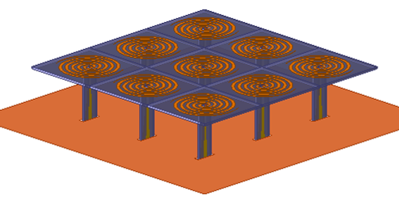
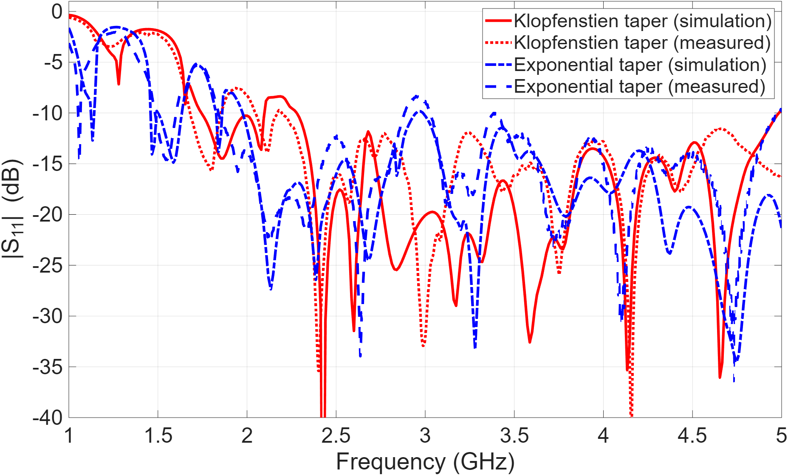

# Archimedean Spiral Array

Two 3 x 3 Archimedean spiral arrays were designed with vertically integrated Klopfenstein and exponential tapered
baluns. Both arrays were fabricated, and measured input matching was compared with HFSS simulation.

Figure 1. Fabricated Klopfenstein-fed array.

## Design and Results

The baluns transform the 50 ohm unbalanced input to the balanced spiral impedance. The feed geometry was
optimized in HFSS, then integrated vertically into the array. Matching, interelement coupling, and element patterns
were compared for the two taper profiles.

Figure 2. HFSS model of the Klopfenstein-fed array.

Figure 3. Simulated and measured input matching.

The Klopfenstein feed provides more continuous impedance coverage over the studied band. The exponential feed
shows slightly higher average isolation in the simulated comparison. The center-element patterns are similar, but
differences are more noticeable at the corner element. This shows why finite-array edge effects need to be included.

## Files

- [Paper](docs/spiral-array-paper.pdf)
- [HFSS archive](models/ArchimedeanSpiralArrayExport_Fall2026.aedtz)
- [Simulated coupling](figures/simulated-coupling.png)
- [Center-element pattern](figures/center-element-pattern.png)
- [Corner-element pattern](figures/corner-element-pattern.png)

The paper lists Leo Alvelais, Paul Obrecht, Payam Nayeri, and Steve Dunton. Restore the `.aedtz` archive in HFSS
to inspect the model.

[Antenna designs](../README.md) | [Portfolio](../../README.md)
