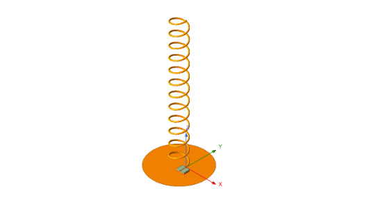
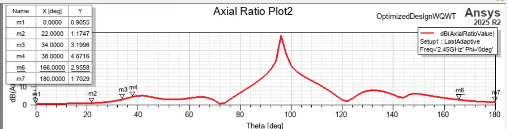

# 2-3 GHz Axial-Mode Helical Antenna

An axial-mode helical antenna consisting of a helix, ground plane, and printed match track. The helix and matching
section were optimized together for 2-3 GHz operation.

Figure 1. Helical antenna geometry from the earlier laboratory report.

## Design and Results

The input port was first de-embedded to inspect the helix impedance. An FR4 printed match track was used to create the 
most optimal match to 50 Ohms. 

The notes compare turn count, wire radius, feed offset, pitch angle, and matching-line length. The supplied model
uses twelve turns. Wire-gauge variants were also studied for fabrication.

Figure 2. Simulated input matching for one match-track iteration.

Figure 3. Simulated axial ratio versus angle at 2.45 GHz.

These plots are from separate design iterations. They should be compared with the corresponding geometry and wire
size. Fabrication measurements are not included.

## Files

- [HFSS project](models/AxialModeHelicalAntenna_2to3GHz.aedt)
- [Design history](docs/design-history.md)
- [Gain cut](figures/notebook-gain-cut.png)
- [Model parameters](figures/design-parameter-snapshot.png)
- [10 AWG variant](figures/s11-10awg-variant.png)
- [12 AWG variant](figures/s11-12awg-variant.png)
- [Earlier laboratory report](../../Antenna-measurement-system/antenna-measurement-system/docs/communication-and-measurement-report.pdf)

Helix and match-track optimization: Leo Alvelais. The contextual geometry image is from the team laboratory report.

[Antenna designs](../README.md) | [Portfolio](../../README.md)
