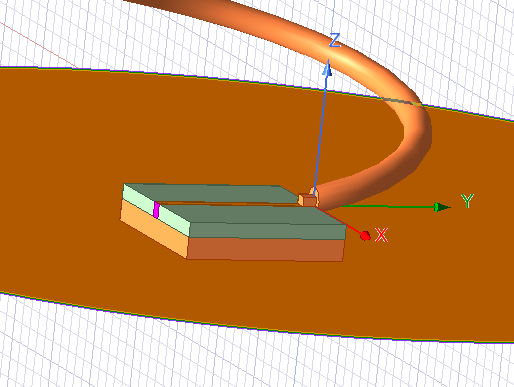

# Helical Antenna Design History

The working notes follow several design iterations rather than one fixed set of final results.

| Notebook pages | Design step |
| --- | --- |
| 1-6 | Initial geometry, retuning, and a de-embedded input-impedance study |
| 7-14 | Quarter-wave transformer synthesis in ADS, conductor-thickness checks, and full-wave integration |
| 15-18 | Helix parameter optimization and comparison of nine- and twelve-turn configurations |
| 19-21 | Revision of the printed match track using the complex antenna impedance and adjustment of its electrical length |
| 22-24 | Gain, axial ratio, and a snapshot of the model parameters |
| 25-27 | Fabrication planning and comparison of wire-gauge variants |

## Feed Matching

The first matching approach used a single quarter-wave transformer between the 50 ohm input and the higher
impedance helix. Its isolated circuit response did not carry over directly when placed in the full antenna model.
The later match-track study accounts for the complex load and tunes the physical line in HFSS.

*Figure 4 - A matching-section geometry from the quarter-wave feed investigation, notebook page 19.*

The notes record a calculated matching-line impedance near 82.3 ohms and subsequent length adjustments. Those
synthesis values describe an intermediate step, rather than fixed dimensions for every later variant.

## Helix and Fabrication Studies

The supplied model uses twelve turns, a 1.4 mm wire radius, a 2.3 mm feed offset, and a 13.3-degree pitch angle.
Later notebook screenshots examine available copper-wire gauges and fixture changes. They are kept as separate
iteration snapshots so that matching plots are not attributed to the wrong geometry.

No fabrication measurements are supplied with these notes. Gain and axial-ratio figures are HFSS simulations.
A final summary should use the same geometry, frequency sweep, and wire dimensions for all reported metrics.

[Back to helical antenna](../README.md)
