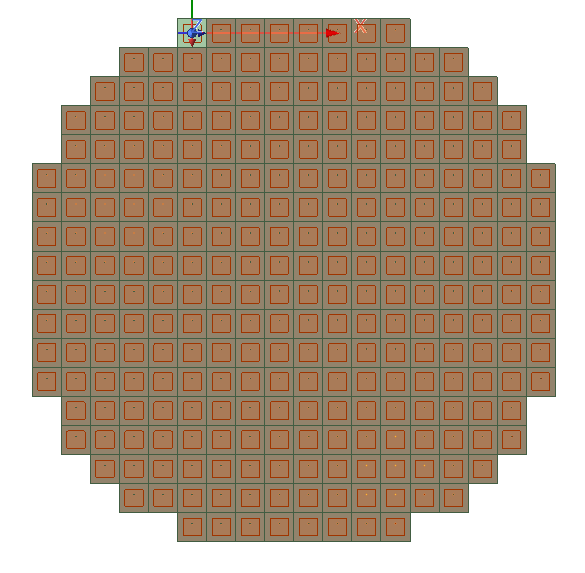
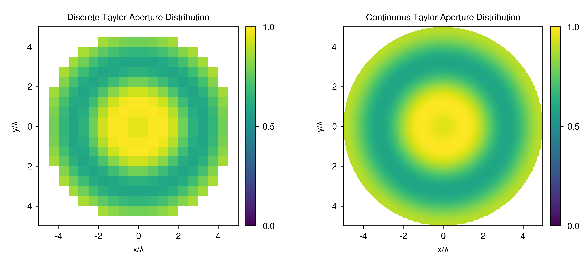

# 2.4 GHz Probe-Fed Patch Array

A probe-fed patch array with a circular Taylor aperture at 2.4 GHz.

Figure 1. Circular array layout from the earlier design report.

## Aperture Modelling

MATLAB was used to compare uniform square and circular apertures with a circular Taylor distribution. Removing
the corner elements changed the sidelobes from a rectangular pattern to roughly concentric rings. The continuous
Taylor distribution was then sampled at the element centers to obtain the excitation weights.

Figure 2. Sampled and continuous Taylor amplitude distributions.

## Patch and Array Design

The patch uses a coaxial probe and a Rogers RT/duroid 5880 substrate. Initial width and length estimates were
calculated in MATLAB. The probe offset and patch geometry were then optimized in HFSS to improve matching.

Lattice pairs and Floquet ports were used for the infinite-array unit cell. The radiation patterns in the report were
obtained with coax excitation. The field distributions are consistent with TM10 operation.

PyAEDT was used to construct the circular array and apply the amplitude weights. HFSS hybrid arrays solution type is used to 
truncate the simulation time. 

## Files

- [HFSS project](models/ProbeFedPatchArray_CircularAperture_TaylorTaper.aedt)
- [Initial patch dimensions](matlab/initial_patch_dimensions.m)
- [Uniform square array](matlab/uniform_square_array_factor.m)
- [Uniform circular array](matlab/uniform_circular_array_factor.m)
- [Sampled circular Taylor array](matlab/circular_taylor_array_factor.m)
- [Continuous circular Taylor aperture](matlab/continuous_circular_taylor_aperture.m)
- [Additional analytical plots](figures/README.md)

[Antenna designs](../README.md) | [Portfolio](../../../README.md)
