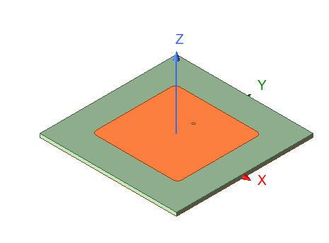
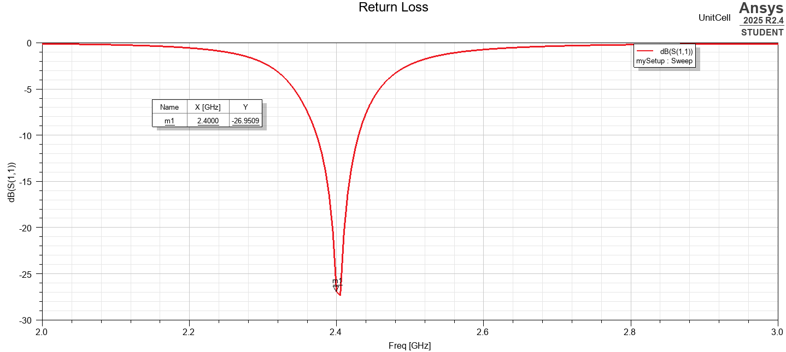
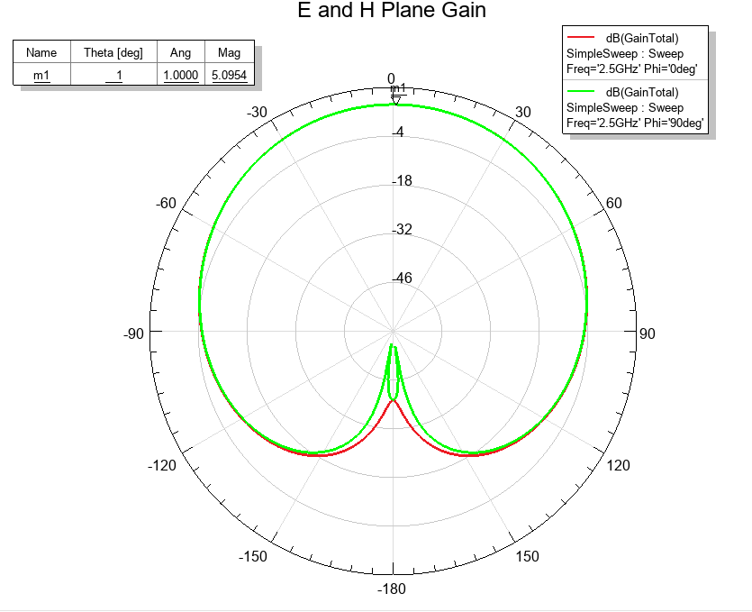
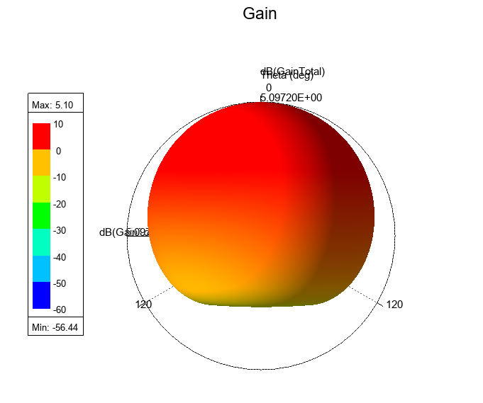
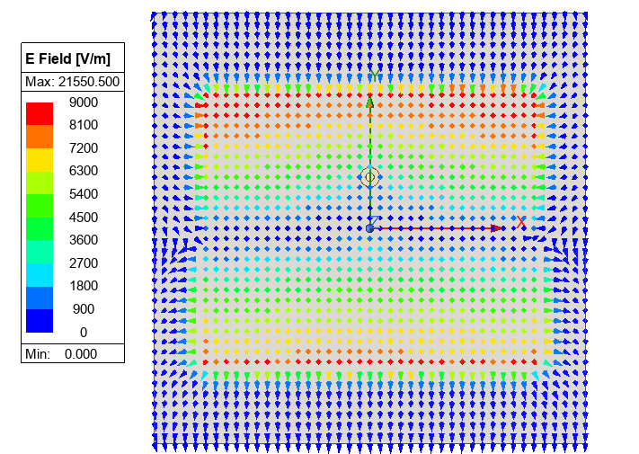
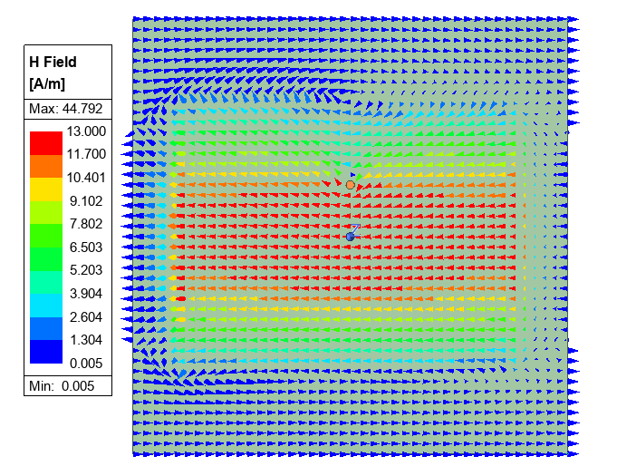

# Unit Cell and Model Revisions

These figures are from the original 2.4 GHz design report. Their frequency labels are retained.

Figure 3. Patch geometry after optimization.

Figure 4. Input matching of the earlier unit-cell revision.

The optimized geometry shows a stronger input match near the design frequency. The patch is slightly rectangular,
which may affect scanning differently in the two principal planes.

Figure 5. Total-gain plane cuts with coax excitation.

Both cuts show broadside radiation with little difference in the main beam.

Figure 6. Three-dimensional total-gain pattern with coax excitation.

Figure 7. Electric field in the substrate.

Figure 8. Magnetic field in the substrate.

The electric field is strongest near the radiating edges and weaker near the center. The magnetic field is strongest
through the middle of the patch. These distributions are consistent with TM10 operation.

## Current Project File

| Design | Frequency information in the attached project |
| --- | --- |
| ProbeFedPatch | Broadband setup and a saved 4 GHz adaptive-result reference |
| UnitCell | Adaptive frequency of 2.45 GHz; sweep from 2 to 3 GHz |
| CircularTaylor_FADDM | Adaptive frequency and sweep point at 2.4 GHz |

The source report also retains its original 2.4/2.45 GHz title. Its plots do not verify the 4 GHz revision. The unit-cell
and array setups need to be made consistent before a full-array result can be reported at 4 GHz. The supplied
project was inspected but was not changed or solved while preparing this page.

## MATLAB Note

The scripts use wavelength-normalized coordinates. In `circular_taylor_array_factor.m`, the first indexed assignment
to `w` precedes its initialization. Initialize the weight array before that assignment when running the script from a
clean workspace. The original analysis files are retained.

Only the patch width and length from `initial_patch_dimensions.m` were used for the probe-fed design. Its remaining
outputs describe the original inset-feed calculation.

[Patch array](../README.md)
