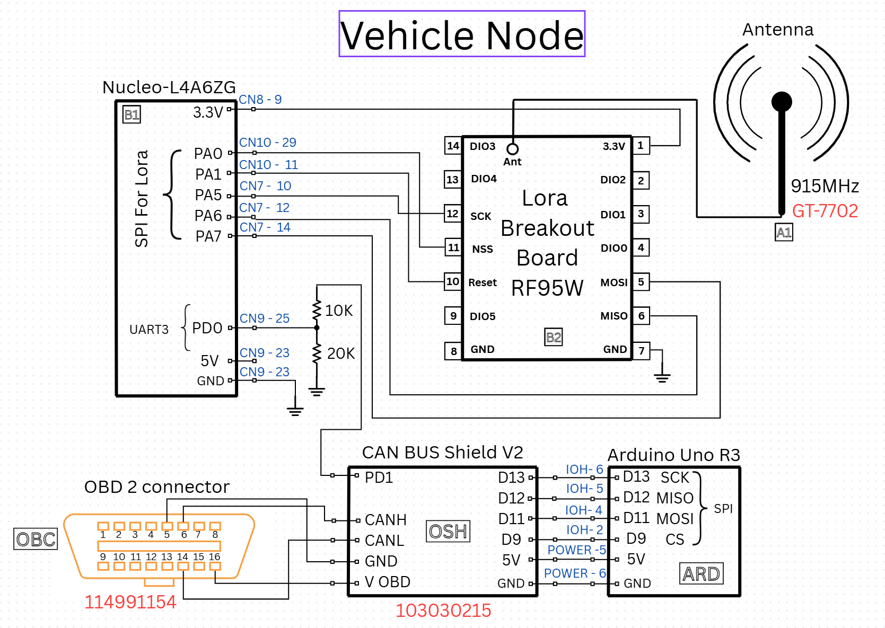

# LoRide: Vehicle Health Monitoring with LoRa

A wireless vehicle-health monitoring project linking OBD-II/CAN data acquisition with STM32 firmware and a
915 MHz LoRa link. A vehicle node formats sensor values into a compact payload, and a base node receives and
displays the telemetry over a serial terminal.

**Status:** Team report, hardware documentation, and a firmware source snapshot are available.

## System

The vehicle interface uses an Arduino and MCP2515-based CAN shield to acquire OBD-II responses. Data passes
over UART to a NUCLEO-L4A6ZG, which communicates with an RFM95W radio over SPI. A second STM32/radio node
receives the LoRa packets and prints the recovered values through a UART terminal interface.

The report describes a 915 MHz carrier, a 125 kHz LoRa bandwidth, and a ten-byte telemetry payload containing
five two-byte vehicle quantities. These include engine speed, vehicle speed, coolant temperature, mass airflow,
and intake-air temperature. The protocol is a one-way telemetry stream without acknowledgements.

## Firmware Snapshot

| File | Role |
| --- | --- |
| [main.c](source/main.c) / [main.h](source/main.h) | Application initialization and node entry-point selection |
| [SPI.c](source/SPI.c) / [SPI.h](source/SPI.h) | SPI interface, RFM95 configuration, and node routines |
| [UART3.c](source/UART3.c) / [UART3.h](source/UART3.h) | Arduino-to-STM32 serial interface |
| [can_read.c](source/can_read.c) / [can_read.h](source/can_read.h) | OBD-II/CAN parsing and sensor conversions |
| [LPUART.c](source/LPUART.c) / [LPUART.h](source/LPUART.h) | Terminal interface |
| [delay.c](source/delay.c) / [delay.h](source/delay.h) | SysTick-based delays |

The supplied `main.c` initializes the peripherals but leaves both `base_node()` and `Vehicle_node()` commented
out. Select the appropriate node entry point before adapting the firmware to hardware. A complete STM32CubeIDE
project, startup files, linker configuration, and vendor support headers are not included in this source snapshot.
The report contains additional source listings and wiring information.

## Files

- [Complete team report, including source listings and references](docs/loride-report.pdf)
- [Original supplied code archive](archive/CODE4REPORT.zip)
- [Base node wiring diagram](figures/base-node-schematic.png)

## Contributions and Credits

Team: Leo Alvelais, Anthony di Furia, Juan Gonzalez, and Ches Zepp. The report attributes the initial SPI framing
work to Leo; source headers also identify his work on terminal and delay utilities. Other modules retain their
individual and team author credits. Juan Gonzalez is credited for the system schematic, and `LPUART.h` also
credits Derek Huie for the shared utility header.

The report acknowledges Seeed Studio, TheGreyDiamond, CSS Electronics, and the STMicroelectronics community.
Original source notices and references are retained.

[Wireless systems and SDR](../README.md) | [Portfolio](../../README.md)
