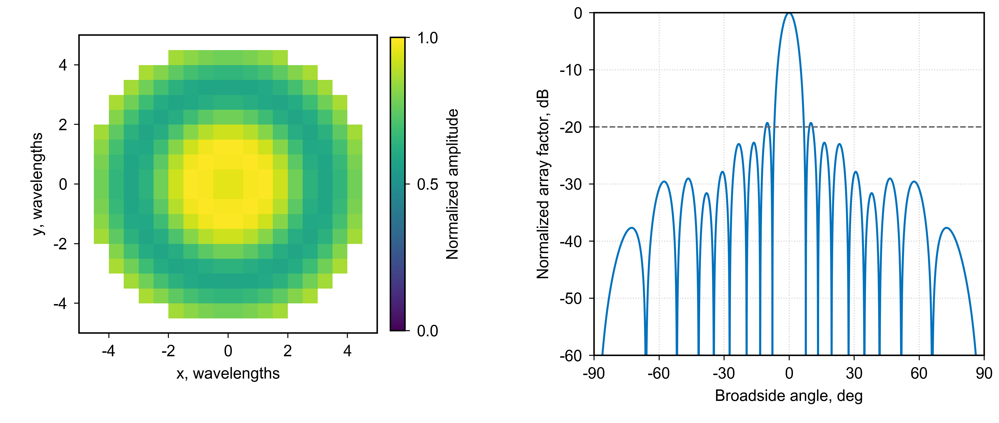

# 2.45 GHz Probe-Fed Patch Phased Array

A probe-fed patch array project supported by MATLAB studies of square and circular apertures, Taylor amplitude
tapering, and normalized radiation-pattern cuts. The current antenna design targets 2.45 GHz and remains under
optimization.

**Status:** Optimization in progress. This package contains the MATLAB aperture studies; the updated HFSS model
and final array results will be added after optimization.

*Figure 1 - Sampled circular Taylor amplitude distribution, left.*

*Figure 2 - Ideal principal-plane array factor, right. The dashed line marks the -20 dB design parameter.*

## Available Analysis

The scripts compare a uniformly excited square grid, a circular selection of that grid, a sampled circular Taylor
distribution, and the corresponding continuous aperture. The supplied studies use a 20 x 20 candidate lattice,
0.5-wavelength spacing, and a circular aperture radius of 5 wavelengths. The Taylor examples use a 20 dB sidelobe
design parameter and nbar = 4.

The plots above were independently recalculated from the equations and parameters in `circular_taylor_array_factor.m`. They show an
ideal array-factor study, not an HFSS result or a measured antenna pattern. It does not include element patterns,
mutual coupling, feed losses, or the ongoing antenna optimization.

| Script | Study |
| --- | --- |
| [uniform_square_array_factor.m](matlab/uniform_square_array_factor.m) | Uniform square-array factor and principal cuts |
| [uniform_circular_array_factor.m](matlab/uniform_circular_array_factor.m) | Circular selection of the square lattice |
| [circular_taylor_array_factor.m](matlab/circular_taylor_array_factor.m) | Sampled circular Taylor aperture and array factor |
| [continuous_circular_taylor_aperture.m](matlab/continuous_circular_taylor_aperture.m) | Continuous circular Taylor aperture integral |

## Use and Development Notes

Inspect the scripts in MATLAB with support for local functions in scripts. Coordinates are normalized to wavelength,
so these aperture calculations do not themselves establish the antenna's operating frequency. The source folder
supplied with the project used a 2.5 GHz label; this page follows the current 2.45 GHz target provided by Leo.

These are development snapshots. In `circular_taylor_array_factor.m`, the first masked assignment to `w` occurs before `w` is initialized;
initialize a 20 x 20 weight array before that assignment when running from a clean workspace. The continuous
integral and dense array-factor grids may take time to evaluate. The scripts have been preserved as supplied.

[Preview-figure method and reproduction script](figures/README.md)

[All antenna designs](../README.md) | [Portfolio](../../README.md)
