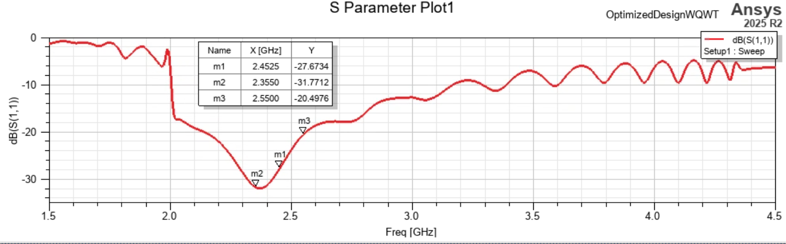

# 2-3 GHz Axial-Mode Helical Antenna

An axial-mode helical antenna with a printed match track, optimized toward operation over 2-3 GHz. The design
notes document port-impedance studies, matching-section revisions, and changes to the helix and wire diameter.

**Available material:** HFSS model, a design history based on the working notebook, and simulation screenshots.

*Figure 1 - Helical antenna geometry shown in the earlier laboratory report.*

## Design Development

The feed study started by de-embedding the input port and inspecting the helix impedance. An initial quarter-wave
transformer was checked in ADS, then evaluated with the full three-dimensional antenna. Differences after integration
prompted further changes to the helix and printed matching section.

The notes compare turn counts and examine how wire radius, feed offset, pitch angle, and matching-line length affect
the response. The later design uses a printed match track adjusted from the complex antenna impedance. Wire-gauge
variants were then compared for fabrication.

[Design history and source-page references](docs/design-history.md)

## Parameters in the Supplied HFSS Model

| Parameter | Value |
| --- | --- |
| Number of turns | 12 |
| Helix wire radius | 1.4 mm |
| Feed-to-helix offset | 2.3 mm |
| Pitch angle | 13.3 degrees |

The notebook's parameter-table screenshot and the supplied model give the pitch as an angle in degrees. The later
wire-gauge screenshots are design variants and should be read with their respective geometry settings.

## Simulation Snapshots

*Figure 2 - Simulated input reflection coefficient from the match-track iteration, notebook page 21.*

*Figure 3 - Simulated axial ratio versus angle at 2.45 GHz, notebook page 23.*

These screenshots document stages of the design process. They are not treated as measurements or as a single final
validation dataset for every wire-gauge variant. The 2-3 GHz range is the optimization target; continuous performance
across that band should be assessed with a consistent final geometry and solution set.

## Files

- [HFSS project](models/AxialModeHelicalAntenna_2to3GHz.aedt)
- [Design history](docs/design-history.md)
- [Gain cut from the notebook](figures/notebook-gain-cut.png)
- [Parameter-table screenshot](figures/design-parameter-snapshot.png)
- [10 AWG wire variant](figures/s11-10awg-variant.png)
- [12 AWG wire variant](figures/s11-12awg-variant.png)
- [Earlier team laboratory report, Section III-B](../../measurement-automation/antenna-measurement-system/docs/communication-and-measurement-report.pdf)

Open the project in Ansys Electronics Desktop / HFSS. A separate solver-results directory was not supplied, so new
solutions may be needed to regenerate results. Original screenshots retain their source colors, curves, and resolution.

## Contribution and Credits

Leo Alvelais optimized the helix and printed match track. The working notebook supplies the design progression and
simulation snapshots. The contextual geometry image comes from the collaborative laboratory report, whose authors
are listed in [Credits and References](../../CREDITS.md).

[All antenna designs](../README.md) | [Portfolio](../../README.md)
